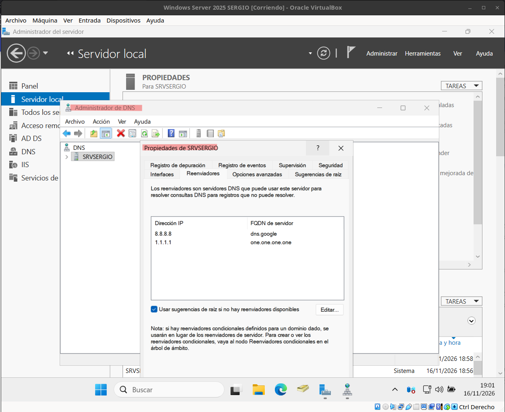
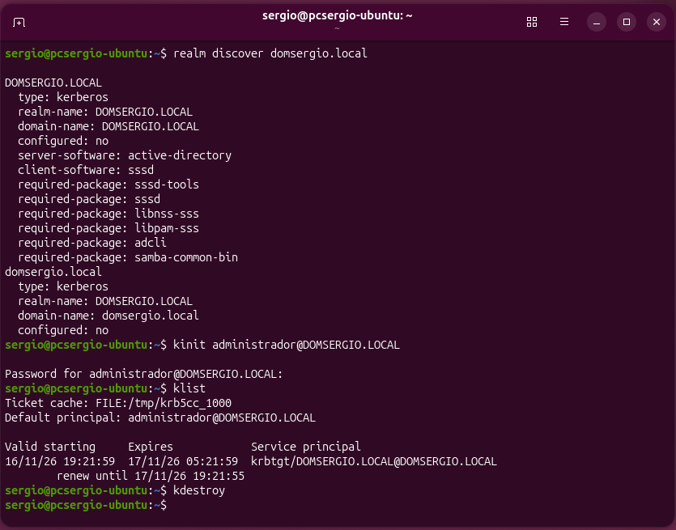
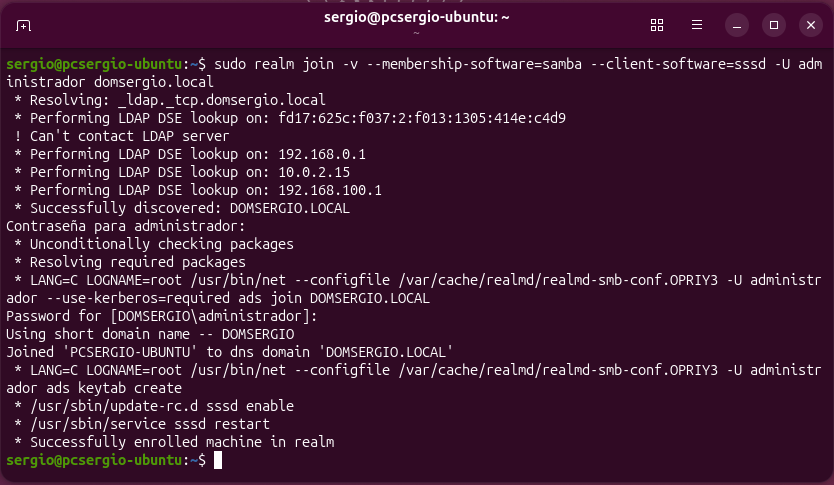
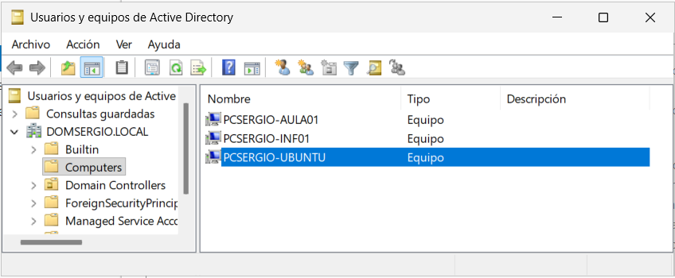
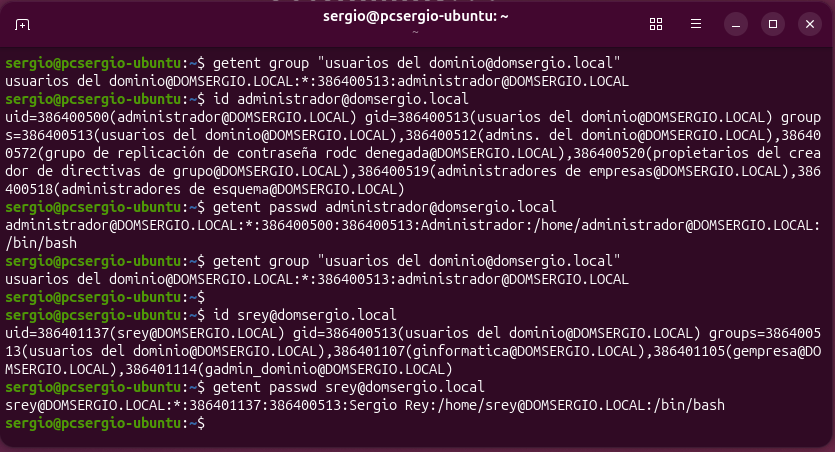
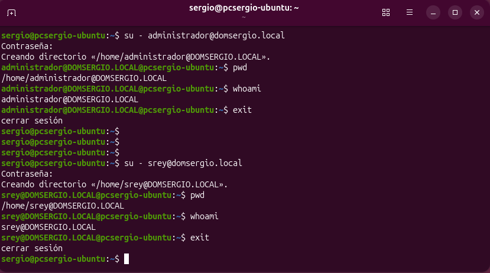
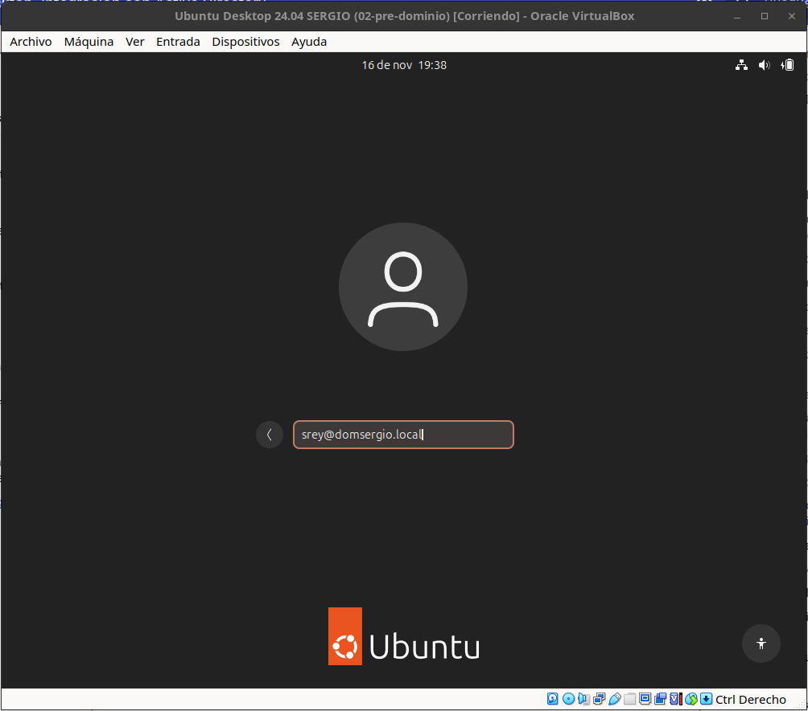

## Integración de Ubuntu Desktop con Active Directory

Ahora llega la parte más interesante: vamos a unir este equipo Ubuntu Desktop al dominio Active Directory de Windows Server que creamos en temas anteriores. Una vez completada la integración, los usuarios del dominio podrán iniciar sesión en Ubuntu con sus credenciales corporativas, exactamente igual que lo hacen en los equipos Windows.

### Introducción a la integración

La integración de Linux con Active Directory es una necesidad real en empresas con infraestructuras híbridas. Permite:

**Centralizar la gestión de usuarios**: Un único lugar (Active Directory) gestiona las credenciales de todos los equipos, tanto Windows como Linux.

**Single Sign-On (SSO)**: Los usuarios inician sesión una vez y pueden acceder a recursos tanto en servidores Windows como Linux sin volver a autenticarse.

**Auditoría unificada**: Todos los inicios de sesión, tanto Windows como Linux, quedan registrados en el controlador de dominio.

**Experiencia consistente para usuarios**: Los usuarios no necesitan recordar diferentes credenciales para diferentes sistemas.

### Tecnologías involucradas

La integración utiliza varias tecnologías que trabajan juntas:

**DNS**: Permite al equipo Linux localizar el controlador de dominio. Active Directory publica en su DNS registros especiales (registros SRV) que indican dónde está cada servicio.

**Kerberos**: Protocolo de autenticación que usa Active Directory. Permite autenticación segura sin enviar contraseñas por la red.

**LDAP**: Protocolo de directorio con el que se consulta la información de los usuarios y los grupos.

**Realmd**: Servicio que simplifica el descubrimiento y la unión a dominios Active Directory.

**SSSD** (System Security Services Daemon): Demonio que gestiona la identidad y la autenticación de los usuarios del dominio. Hace de intermediario entre Linux y Active Directory.

**Samba**: Aunque no lo usaremos para compartir archivos en el Desktop, sus utilidades (`net ads`) son las que darán de alta nuestro equipo en el dominio.

### Cómo funciona: qué ocurre cuando un usuario inicia sesión

```
┌──────────────────┐   1. ¿Dónde está el dominio?        ┌─────────────────────┐
│  Ubuntu Desktop  │ ──────────── DNS (SRV) ───────────▶ │   Windows Server    │
│                  │   2. Validar usuario y contraseña   │                     │
│   SSSD + PAM     │ ──────────── Kerberos ────────────▶ │   DNS + Kerberos    │
│                  │   3. UID, grupos, datos del usuario │   + LDAP            │
│                  │ ──────────── LDAP ────────────────▶ │                     │
└──────────────────┘                                     └─────────────────────┘
```

Para que esto funcione, el equipo Ubuntu debe estar previamente **dado de alta en el dominio**, igual que un equipo Windows: Active Directory crea una **cuenta de equipo** y se establece un secreto compartido entre ambos.

### La escalera de comprobaciones

Cada fase de este apartado depende de la anterior:

    1. Red e IP  
    2. DNS del dominio  
    3. Hora  
    4. Kerberos  
    5. Alta del equipo  
    6. Identidad (SSSD)  
    7. Inicio de sesión

Si un peldaño falla, todos los siguientes fallarán, y el error que veamos al final no nos dirá cuál fue el verdadero problema. Por eso, **después de cada fase hay una comprobación**.

!!!warning "Regla de oro de este apartado"

    Si una comprobación no da el resultado que se indica, **parad**. No sigáis con la fase siguiente, no probéis comandos al azar y no repitáis la unión al dominio varias veces. Restaurad la instantánea anterior o avisad al profesor con la información de diagnóstico que se indica al final del apartado.

### Instantáneas de este apartado

Trabajaremos con tres instantáneas de la máquina virtual:

| Instantánea | Cuándo se crea |
|-------------|----------------|
| `01-base-actualizada` | Al terminar el apartado anterior (sistema actualizado, Guest Additions y login gráfico comprobados) |
| `02-pre-dominio` | Al final de la Fase 4, con todo comprobado y **antes** de unir al dominio |
| `03-en-dominio` | Al final de la Fase 9, con el equipo ya en el dominio y el login gráfico comprobado |

### Datos de nuestro entorno

Sustituid los valores `XXX` por los de vuestro entorno en todos los comandos:

| Dato | Valor en estos apuntes |
|------|------------------------|
| Dominio | `DOMXXX.local` |
| Reino Kerberos (en mayúsculas) | `DOMXXX.LOCAL` |
| Servidor Windows (controlador de dominio, DNS y puerta de enlace) | `srvXXX`, IP `192.168.100.1` |
| Equipo Ubuntu | `pcXXX-ubuntu` (máximo 15 caracteres), IP `192.168.100.XX` |
| Administrador del dominio | `Administrador` (en un Windows Server en español) |

!!!note "Mayúsculas y minúsculas"

    El DNS no distingue entre mayúsculas y minúsculas, pero **Kerberos sí**: el reino debe escribirse siempre en mayúsculas (`DOMXXX.LOCAL`). En los comandos de este apartado el dominio aparece en minúsculas (`domxxx.local`) cuando se trata de un nombre DNS, y en mayúsculas cuando se trata del reino Kerberos.

    - Kerberos --> mayúsculas
    - DNS --> minúsculas

!!!note "Idioma del servidor"

    Los nombres de los grupos integrados dependen del idioma de Windows Server. En un servidor en español el grupo de todos los usuarios se llama `usuarios del dominio`; en uno en inglés, `domain users`. Usad los nombres que veáis en vuestro servidor.

---

## Fase 0. Preparación del servidor

Antes de tocar el equipo Ubuntu, comprobamos que el servidor está listo. Todo esto se hace en el **Windows Server**.

**0.1. El servidor está encendido** y los servicios de dominio funcionan. Es el equipo al que Ubuntu va a preguntar por todo.

**0.2. El DNS del servidor tiene un reenviador a Internet**. Como el equipo Ubuntu usará solo el DNS del servidor, es éste quien debe resolver los nombres de Internet (necesitaremos Internet para instalar paquetes). Se configuró en el apartado de red; si no lo hicisteis, en el Administrador de DNS: clic derecho sobre el servidor → Propiedades → **Reenviadores** → `1.1.1.1`.

<figure markdown="span" align="center">
  { width="80%" }
  <figcaption>Configuracíón de reenviadores del controlador de dominio</figcaption>
</figure>


**0.3. No existe ya un objeto de equipo con el mismo nombre**. Abrid **Usuarios y equipos de Active Directory**, mirad el contenedor **Computers** y eliminad el objeto `PCXXX-UBUNTU` si existe de un intento anterior. Un objeto sobrante de un intento fallido hace fallar la unión siguiente.

**0.4. Hay al menos dos usuarios del dominio con contraseña conocida**: el `Administrador` y otro usuario normal (por ejemplo, uno de los creados en temas anteriores). Los usaremos para las pruebas.

**0.5. Anotad la hora del servidor**. En PowerShell:

```powershell
Get-Date
```

La necesitaremos en la Fase 2, porque Kerberos no tolera diferencias de hora grandes entre cliente y servidor.

---

## Fase 1. Comprobar el equipo base

Arrancad la máquina virtual y abrid una terminal. Comprobamos que partimos de una base correcta:

```bash
lsb_release -d
uname -r
systemctl status vboxadd --no-pager | head -5
```

!!!success "Resultado esperado"

    - Ubuntu 26.04 LTS.
    - `vboxadd` en estado `active (exited)`.

!!!failure "Si no coincide"

    Si `vboxadd` aparece en `failed`, volved al apartado de Guest Additions y resolvedlo antes de seguir. Un fallo aquí no tiene que ver con el dominio, pero si lo dejamos pasar luego no sabremos distinguirlo de un problema de la integración.

Ahora fijamos el **nombre completo del equipo** (FQDN):

```bash
sudo hostnamectl set-hostname pcXXX-ubuntu.domxxx.local
sudoedit /etc/hosts
```

En `/etc/hosts`, sustituid la línea que empieza por `127.0.1.1` por esta:

```
127.0.1.1   pcXXX-ubuntu.domxxx.local   pcXXX-ubuntu
```

Comprobamos:

```bash
hostname -f
```

!!!success "Resultado esperado"

    ```
    pcXXX-ubuntu.domxxx.local
    ```

---

## Fase 2. Red, DNS y hora

El equipo debe tener ya la IP fija y el DNS configurados según el apartado de red (Netplan o NetworkManager). Lo comprobamos.

### 2.1. Red

```bash
ip -4 -br addr
ip route
ping -c 2 192.168.100.1
```

!!!success "Resultado esperado"

    - La interfaz (`enp0s3` o similar) tiene la IP `192.168.100.XX/24`.
    - Existe una ruta `default via 192.168.100.1`.
    - El ping al servidor responde.

### 2.2. DNS

```bash
resolvectl status
```

!!!success "Resultado esperado"

    En la sección de vuestra interfaz:

    ```
    Current DNS Server: 192.168.100.1
           DNS Servers: 192.168.100.1
            DNS Domain: domxxx.local
    ```

    El **único** servidor DNS debe ser el del Windows Server. Si aparece otro, el equipo puede acabar preguntándole a él por el dominio, y fallará de forma intermitente.

Ahora comprobamos que el DNS del servidor conoce el dominio:

```bash
getent hosts srvXXX.domxxx.local
resolvectl query --type=SRV _ldap._tcp.domxxx.local
```

!!!success "Resultado esperado"

    - El primer comando devuelve `192.168.100.1 srvXXX.domxxx.local`.
    - El segundo devuelve registros SRV con el nombre de vuestro servidor. Son los registros que el equipo usará para encontrar el controlador de dominio.

!!!failure "Si no coincide"

    No sigáis. Las causas más habituales:

    - Hay un segundo DNS configurado en la interfaz (revisad el apartado de red).
    - El servidor está apagado o no tiene el rol DNS funcionando.
    - El nombre del dominio está mal escrito.

### 2.3. Hora

```bash
date
timedatectl | grep -E "synchronized|NTP service"
```

Comparad la hora con la que anotasteis del servidor en la Fase 0. Debe haber una diferencia de **segundos**, no de minutos.

!!!tip "Si hay más de un minuto de diferencia"

    Hacemos que Ubuntu sincronice su hora con el controlador de dominio:

    ```bash
    sudo mkdir -p /etc/systemd/timesyncd.conf.d
    printf "[Time]\nNTP=192.168.100.1\n" | sudo tee /etc/systemd/timesyncd.conf.d/dominio.conf
    sudo systemctl restart systemd-timesyncd
    timedatectl timesync-status
    ```

    Esperad unos segundos y volved a comparar con `date`.

---

## Fase 3. Instalar los paquetes

Con el DNS funcionando y salida a Internet a través del servidor, instalamos todo lo necesario:

```bash
sudo apt update
sudo apt install -y realmd sssd sssd-ad sssd-tools adcli samba-common-bin \
  krb5-user packagekit oddjob oddjob-mkhomedir libnss-sss libpam-sss
```

Durante la instalación de `krb5-user`, el sistema hace tres preguntas (según versiones puede hacer tres preguntas, solo la primera de ellas o ninguna):

| Pregunta | Respuesta |
|----------|-----------|
| Reino predeterminado de Kerberos (*Default Kerberos version 5 realm*) | `DOMXXX.LOCAL` (mayúsculas) |
| Servidores Kerberos para el reino | `srvXXX.domxxx.local` |
| Servidor administrativo para el reino | `srvXXX.domxxx.local` |

Qué hace cada paquete:

- `realmd`: la herramienta `realm`, que descubre y une al dominio.
- `sssd`, `sssd-ad`, `sssd-tools`: el servicio que gestiona los usuarios del dominio.
- `adcli`, `samba-common-bin`: utilidades de alta del equipo en el dominio (`samba-common-bin` incluye `net`, que usaremos).
- `krb5-user`: herramientas Kerberos (`kinit`, `klist`).
- `libnss-sss`, `libpam-sss`: conectan el sistema con SSSD para resolver usuarios y autenticar.
- `oddjob`, `oddjob-mkhomedir`: crean la carpeta personal de un usuario cuando entra por primera vez.
- `packagekit`: requerido por `realm`.

Comprobamos:

```bash
realm --version
```

!!!success "Resultado esperado"

    Muestra la versión de `realm` sin errores.

!!!failure "Si `apt update` falla"

    Si el equipo no resuelve nombres de Internet, el problema está en el servidor: falta el reenviador DNS (Fase 0.2) o el servidor no da salida a Internet. No es un problema del cliente Ubuntu.

---

## Fase 4. Descubrir el dominio y comprobar Kerberos

### 4.1. Descubrir el dominio

```bash
realm discover domxxx.local
```

!!!success "Resultado esperado"

    La salida debe incluir estas líneas:

    ```
    domxxx.local
      type: kerberos
      realm-name: DOMXXX.LOCAL
      domain-name: domxxx.local
      configured: no
      server-software: active-directory
    ```

!!!failure "Si dice «No such realm found»"

    El equipo no encuentra el dominio: es un problema de DNS. Volved a la Fase 2.2 y no sigáis.

### 4.2. Pedir un ticket Kerberos

Con esto comprobamos que el equipo puede autenticarse contra el dominio, sin haberse unido todavía:

```bash
kinit administrador@DOMXXX.LOCAL
klist
```

!!!success "Resultado esperado"

    `kinit` pide la contraseña y no muestra nada. `klist` muestra un ticket para `krbtgt/DOMXXX.LOCAL@DOMXXX.LOCAL`.

<!-- CAPTURA: terminal con kinit y klist mostrando el ticket krbtgt/DOMXXX.LOCAL@DOMXXX.LOCAL -->
<figure markdown="span" align="center">
  { width="80%" }
  <figcaption>Ticket Kerberos obtenido para el Administrador del dominio</figcaption>
</figure>

!!!failure "Si `kinit` falla"

    Mirad el mensaje:

    - `Cannot find KDC for realm`: el reino está mal escrito (¿mayúsculas?) o falla el DNS.
    - `Clock skew too great`: la hora del equipo y del servidor difieren demasiado (Fase 2.3).
    - `Password incorrect` o `Preauthentication failed`: usuario o contraseña incorrectos. En un Windows Server en español el usuario es `administrador`, no `administrator`.

Liberamos el ticket:

```bash
kdestroy
```

### 4.3. Instantánea

Hasta aquí no hemos cambiado nada en el dominio, y ya sabemos que red, DNS, hora y Kerberos funcionan. Apagad el equipo y creadla:

1. **Máquina → Tomar instantánea**
2. Nombre: `02-pre-dominio`

Si algo falla a partir de ahora, volver a este punto os ahorra repetir todo lo anterior.

---

## Fase 5. Unir el equipo al dominio

Esta es la fase central. Antes de ejecutarla, repasad la Fase 0.3: no debe existir en el servidor un objeto de equipo con el nombre de vuestro Ubuntu.

```bash
sudo realm join -v --membership-software=samba --client-software=sssd -U administrador domxxx.local
```

Cada parte del comando:

- `realm join`: unir el equipo al dominio.
- `-v`: modo detallado, para ver qué hace en cada momento.
- `--membership-software=samba`: el alta del equipo en el dominio la hace Samba (`net ads`).
- `--client-software=sssd`: de los usuarios y las contraseñas se encarga SSSD.
- `-U administrador`: usuario con permiso para añadir equipos al dominio.
- `domxxx.local`: el dominio.

Os pedirá la contraseña del *administrador*.

!!!note "Por qué usamos Samba para el alta del equipo"

    Con Windows Server 2025 se han reportado fallos al dar de alta equipos Linux con `adcli`, el método que `realm` usa por defecto, con el error `Message stream modified`. Para evitarlo, el alta se hace con las utilidades de Samba. Si en algún momento recibís ese error, consultad la sección de resolución de problemas.

!!!success "Resultado esperado"

    La salida termina con:

    ```
    * Successfully enrolled machine in realm
    ```

Comprobamos el estado:

```bash
realm list
```

!!!success "Resultado esperado"

    ```
    DOMXXX.LOCAL
      type: kerberos
      realm-name: DOMXXX.LOCAL
      domain-name: domxxx.local
      configured: kerberos-member
      server-software: active-directory
      client-software: sssd
      ...
      login-formats: %U@domxxx.local
      login-policy: allow-realm-logins
    ```

    - `configured: kerberos-member`: el equipo es miembro del dominio.
    - `login-formats: %U@domxxx.local`: los usuarios se escriben como `usuario@domxxx.local`.
    - `login-policy: allow-realm-logins`: pueden entrar los usuarios del dominio.

<!-- CAPTURA: terminal con realm join terminando en "Successfully enrolled machine in realm" y la salida de realm list -->
<figure markdown="span" align="center">
  { width="80%" }
  <figcaption>Unión al dominio y estado del equipo</figcaption>
</figure>

Comprobamos también desde el **servidor**: en Usuarios y equipos de Active Directory, contenedor **Computers**, debe haber aparecido un objeto con el nombre de vuestro Ubuntu.

<!-- CAPTURA: Usuarios y equipos de Active Directory, contenedor Computers, con el objeto PCXXX-UBUNTU creado -->
<figure markdown="span" align="center">
  { width="80%" }
  <figcaption>Cuenta de equipo creada en Active Directory</figcaption>
</figure>

!!!failure "Si la unión falla"

    **No repitáis el comando varias veces.** Cada intento fallido puede dejar un objeto de equipo sobrante en el servidor que hará fallar el siguiente. Leed el error completo y consultad la sección de resolución de problemas. Si el error es `Message stream modified`, tenéis la solución allí.

---

## Fase 6. Comprobar la identidad de los usuarios

Ahora comprobamos que Ubuntu ve a los usuarios y grupos del dominio. Recordad que se escriben como `usuario@domxxx.local`.

```bash
id administrador@domxxx.local
getent passwd administrador@domxxx.local
getent group "usuarios del dominio@domxxx.local"
```

!!!success "Resultado esperado"

    ```
    uid=386400500(administrador@DOMXXX.LOCAL) gid=386400513(usuarios del dominio@DOMXXX.LOCAL) groups=...
    ```

    - Aparecen el UID, el grupo principal y los grupos del dominio.
    - Los números serán distintos en cada dominio: SSSD calcula el UID a partir del identificador de seguridad (SID) del usuario en Active Directory.
    - Los grupos con espacios o tildes en el nombre **se escriben entre comillas**.

Repetid `id` con el otro usuario de prueba del dominio.

<!-- CAPTURA: terminal con la salida de id administrador@domxxx.local y getent passwd -->
<figure markdown="span" align="center">
  { width="80%" }
  <figcaption>Identidad de un usuario del dominio resuelta por SSSD</figcaption>
</figure>

!!!failure "Si `id` falla"

    No sigáis. Probad primero a vaciar la caché de SSSD y reiniciar el servicio:

    ```bash
    sudo sss_cache -E
    sudo systemctl restart sssd
    id administrador@domxxx.local
    ```

    Si sigue fallando, anotad la salida de `sudo journalctl -u sssd -n 40 --no-pager` y avisad al profesor.

!!!note "Aviso de SSSD en `systemctl --failed`"

    Es posible que `systemctl --failed` muestre `sssd-nss.socket`, `sssd-pac.socket` y `sssd-pam.socket` en estado `failed`. En nuestras pruebas es un aviso que no afecta al funcionamiento. Si `sssd.service` está `active (running)` (comprobadlo con `systemctl status sssd`) y `id` responde, podéis ignorarlo.

---

## Fase 7. Carpeta personal y acceso

### 7.1. Crear la carpeta personal al primer inicio de sesión

Los usuarios del dominio no tienen carpeta personal en Ubuntu hasta que entran por primera vez. Activamos que se cree automáticamente:

```bash
sudo pam-auth-update --enable mkhomedir
```

Comprobamos que el sistema consulta a SSSD para usuarios y grupos:

```bash
grep -E "^(passwd|group)" /etc/nsswitch.conf
```

!!!success "Resultado esperado"

    Las dos líneas incluyen `sss`:

    ```
    passwd:         files systemd sss
    group:          files systemd sss
    ```

### 7.2. Quién puede entrar

Tras la unión, la política por defecto (`login-policy: allow-realm-logins`, que vimos en `realm list`) permite entrar a **todos los usuarios del dominio**. Es lo que queremos en el laboratorio.

!!!tip "En un entorno real"

    En una empresa normalmente no interesa que cualquier usuario del dominio pueda entrar en cualquier equipo Linux. Se restringe por grupos con `realm`:

    ```bash
    sudo realm deny --all
    sudo realm permit -g "nombre del grupo@domxxx.local"
    ```

    No lo hagáis ahora: lo dejamos como referencia.

---

## Fase 8. Prueba por terminal

Antes de probar la interfaz gráfica, comprobamos el inicio de sesión desde la terminal, que es más sencillo de diagnosticar:

```bash
su - administrador@domxxx.local
```

!!!success "Resultado esperado"

    - Pide la contraseña del dominio.
    - Crea la carpeta `/home/administrador@domxxx.local`.
    - Entráis con el prompt del usuario del dominio.

Comprobad dónde estáis y salid:

```bash
pwd
whoami
exit
```

**Repetid la prueba con el otro usuario del dominio**, el que no es administrador. Es importante: queremos comprobar que funciona para cualquier usuario, no solo para el administrador.

<figure markdown="span" align="center">
  { width="80%" }
  <figcaption>Inicio de sesión con un usuario del dominio</figcaption>
</figure>


!!!failure "Si `su` falla"

    Si `id` funcionaba en la Fase 6 pero `su` no, el problema está en la autenticación (PAM). Mirad `sudo journalctl -u sssd -n 40 --no-pager` y avisad al profesor.

---

## Fase 9. Reiniciar y probar el inicio de sesión gráfico

Este es el objetivo final. **Reiniciad el equipo antes de probar**: hay problemas que solo aparecen tras un reinicio con el equipo ya unido al dominio.

```bash
reboot
```

Cuando aparezca la pantalla de inicio de sesión:

1. Si no aparece el usuario, haced clic en **¿No está en la lista?**
2. Escribid el usuario completo: `usuario@domxxx.local`
3. Introducid la contraseña del dominio

<!-- CAPTURA: pantalla de inicio de sesión de Ubuntu con la opción "¿No está en la lista?" y el usuario del dominio escrito -->
<figure markdown="span" align="center">
  { width="80%" }
  <figcaption>Inicio de sesión gráfico con un usuario del dominio</figcaption>
</figure>

Una vez dentro, abrid una terminal y comprobad:

```bash
whoami
pwd
id
```

!!!success "Resultado esperado"

    - Entráis al escritorio con el usuario del dominio.
    - `whoami` devuelve `usuario@domxxx.local`.
    - `pwd` devuelve `/home/usuario@domxxx.local`.

Cerrad la sesión y **repetid con el otro usuario del dominio**.

!!!failure "Si el inicio de sesión gráfico falla"

    Cambiad a una consola de texto con **Ctrl Derecho + F3** (en VirtualBox, equivale a Ctrl+Alt+F3) y entrad con vuestro usuario local. Allí podéis diagnosticar con tranquilidad. Los síntomas más habituales están en la sección de resolución de problemas.

### Instantánea final

Cuando funcione con dos usuarios distintos, cread la tercera instantánea: **Máquina → Tomar instantánea**, nombre `03-en-dominio`.

---

## Resolución de problemas

### Errores de la unión al dominio

| Síntoma | Causa probable | Qué hacer |
|---------|----------------|-----------|
| `realm discover`: *No such realm found* | El DNS del equipo no resuelve el dominio | Fase 2.2: un único DNS (el del servidor) |
| `kinit`: *Clock skew too great* | Hora distinta entre cliente y servidor | Fase 2.3 |
| `kinit`: *Cannot find KDC for realm* | Reino mal escrito o DNS | Reino en mayúsculas; Fase 2.2 |
| Unión: *Insufficient permissions* o *already exists* | Existe ya el objeto de equipo en el servidor, o el usuario no tiene permiso | Eliminar el objeto en **Computers** y repetir una sola vez |
| Unión: `Message stream modified` | Política de seguridad de Windows Server 2025 (ver abajo) | Solución alternativa de abajo |

!!!warning "Solución alternativa: `Message stream modified`"

    Es un error reportado al unir equipos Linux a un dominio con Windows Server 2025. La causa es una directiva de seguridad del controlador de dominio. Si aparece incluso usando el método de Samba:

    1. En el servidor, **eliminad** el objeto `PCXXX-UBUNTU` de **Computers**.
    2. Abrid `gpmc.msc` → editad la **Default Domain Controllers Policy** → Configuración del equipo → Directivas → Configuración de Windows → Configuración de seguridad → Directivas locales → **Opciones de seguridad**.
    3. Buscad **Controlador de dominio: Denegar la configuración de la contraseña predeterminada de la cuenta de equipo** (*Domain controller: Refuse setting default machine account password*) y ponedla en **Deshabilitada**.
    4. Ejecutad `gpupdate /force` en el servidor.
    5. Repetid la Fase 5 en Ubuntu.

    Esta directiva existe por seguridad. En el laboratorio podemos desactivarla para poder practicar, pero en un entorno real habría que valorar el riesgo.

<!-- CAPTURA: Editor de administración de directivas de grupo con la opción "Controlador de dominio: Denegar la configuración de la contraseña predeterminada de la cuenta de equipo" en Deshabilitada -->
<figure markdown="span" align="center">
  { width="80%" }
  <figcaption>Directiva de seguridad del controlador de dominio</figcaption>
</figure>

### Errores de identidad e inicio de sesión

| Síntoma | Causa probable | Qué hacer |
|---------|----------------|-----------|
| `id usuario@domxxx.local`: *no such user* | SSSD no arrancado o con caché antigua | `sudo sss_cache -E` y `sudo systemctl restart sssd` |
| `id usuario` (sin dominio) no funciona | Los nombres deben ir completos | Escribid `usuario@domxxx.local` |
| `getent group` no devuelve nada | Nombre del grupo mal escrito (idioma, tildes, espacios) | Copiad el nombre desde `id`; entrecomillad |
| `su` pide contraseña y falla | Contraseña incorrecta o problema de PAM | `sudo journalctl -u sssd -n 40 --no-pager` |
| Acepta la contraseña y vuelve a la pantalla de login | No se crea la carpeta personal, o una directiva de grupo deniega el acceso | Ver más abajo |
| Pantalla de login congelada o sin lista de usuarios | Problema gráfico de la máquina virtual, no del dominio | Controlador gráfico VBoxSVGA (ver apartado de instalación) |
| `systemctl --failed` muestra los sockets `sssd-*` | Aviso conocido | Ver nota de la Fase 6 |

!!!tip "Si una directiva de grupo deniega el acceso"

    Si en el registro de SSSD (`sudo journalctl -u sssd -n 40 --no-pager`) aparecen mensajes que mencionan `gpo`, una directiva de Windows está impidiendo el inicio de sesión local. Para comprobarlo, podéis relajarla temporalmente:

    ```bash
    sudoedit /etc/sssd/sssd.conf
    ```

    Añadid, dentro del bloque `[domain/domxxx.local]`, esta línea:

    ```
    ad_gpo_access_control = permissive
    ```

    Y reiniciad SSSD:

    ```bash
    sudo systemctl restart sssd
    ```

    Si con esto funciona, ya sabéis que el problema es una directiva de grupo del dominio. Avisad al profesor.

!!!warning "Clonar máquinas virtuales"

    No clonéis una máquina virtual que ya está unida al dominio: el clon tendría el mismo nombre y la misma cuenta de equipo, y el dominio los confundiría. Si necesitáis otra máquina, clonad la instantánea `02-pre-dominio` (antes de la unión) y cambiad el nombre y la IP.

---

## Qué copiar cuando pidáis ayuda

Si os quedáis atascados, ejecutad estos comandos y llevad el resultado (o una captura) al profesor. Con esto se puede localizar en qué peldaño de la escalera está el fallo, sin tener que adivinarlo:

```bash
hostname -f
ip -4 -br addr
resolvectl status | head -15
date
realm list
sudo journalctl -u sssd -n 40 --no-pager
```

Indicad también **en qué fase estáis** y **qué comando falló**, copiando el mensaje de error completo.

---

## Limitaciones de la integración

Es importante entender que aunque el equipo esté unido al dominio, la experiencia no es exactamente igual a la de Windows:

**Las GPOs de Windows no se aplican** a equipos Linux de la misma forma. No podemos usar Group Policy para configurar Ubuntu. Existen alternativas como Ansible o herramientas específicas como ADsys de Canonical, pero son diferentes sistemas y quedan fuera de este curso.

**Los perfiles móviles de Windows no funcionan** en Linux. Los perfiles son sistemas diferentes. Cada sistema mantiene su configuración independiente.

**Algunas aplicaciones Windows** que dependen de características específicas de Windows no funcionarán en Linux, aunque las credenciales sean las mismas.

**Los scripts de inicio de sesión** (.bat, .vbs) de Windows no se ejecutan en Linux. Deberíamos crear scripts equivalentes en bash si fuera necesario.

A pesar de estas limitaciones, la integración es muy útil porque:

- Centraliza usuarios y contraseñas
- Permite acceso a recursos compartidos en servidores Windows
- Simplifica la gestión cuando tenemos estaciones de trabajo Linux en la empresa
- Los usuarios no necesitan recordar credenciales diferentes

### Diferencias respecto a unir un Windows al dominio

Aunque conceptualmente es similar a unir un equipo Windows al dominio, hay diferencias importantes:

**En Windows**:

- Proceso completamente gráfico
- Unos pocos clics en Propiedades del sistema
- Reinicio y listo

**En Ubuntu Desktop**:

- Requiere instalar varios paquetes
- Configuración mediante comandos y archivos de texto
- Más pasos, pero también más control: en cada fase hemos visto qué papel juega cada pieza (DNS, hora, Kerberos, alta del equipo, identidad y autenticación)
- Conviene reiniciar para comprobar que todo se mantiene tras un arranque
